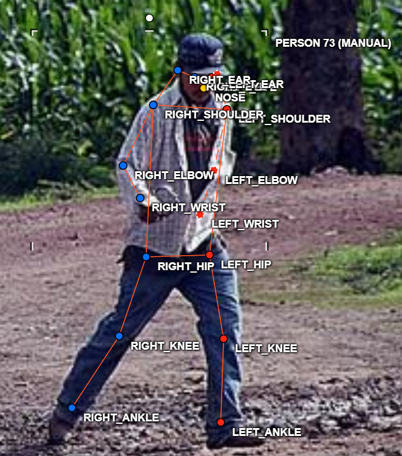
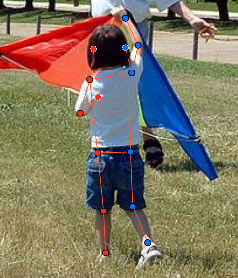
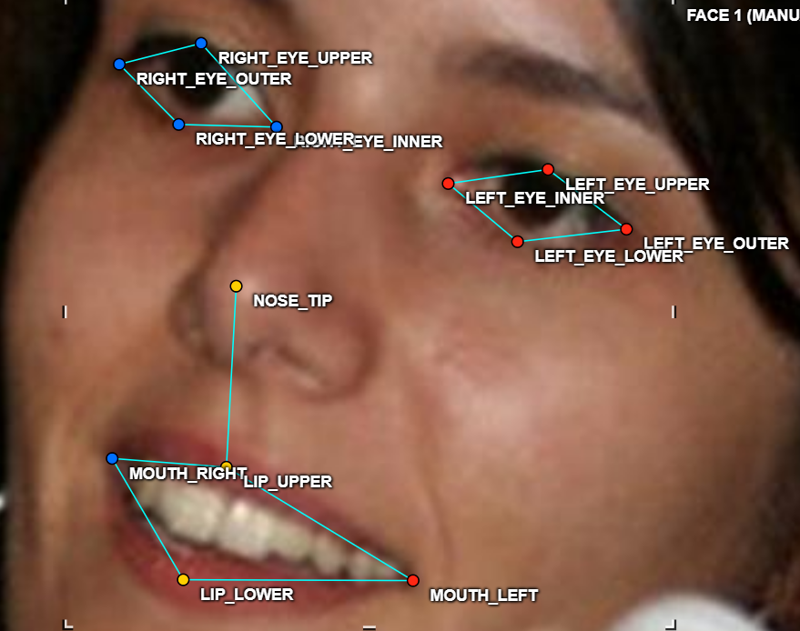
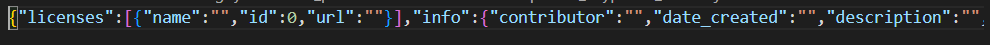

# Báo cáo cá nhân — HoVaTen-MSSV

Đổi tên file theo quy tắc `MSSV_HoTen.md`. Ví dụ: `20241234_NguyenVanAn.md`.

Dữ liệu: 12 ảnh người COCO val2017 và 8 ảnh khuôn mặt cắt từ ảnh COCO, chỉ dùng trong lớp.

## 0. Thông tin học viên

- Họ tên: Nguyễn Thế Anh
- MSSV: 2A202603242 
- Email: ntheanh291@gmail.com
- Link repository:
- Phiên bản CVAT (Help → About): Đã kiểm tra
- Máy: Windows · RAM 7.8 GB · CVAT chế độ đầy đủ
- Bộ ảnh (`src/exports/assignment.json` do `lab.py setup` tạo): Có 
- Giờ bắt đầu: 
- Giờ kết thúc:

## 1. Kiểm tra label (CP0)

| Label | Kiểu | Số điểm | Tên điểm đúng bảng của lab? | Đúng thứ tự? | Số cạnh |
|---|---|---:|---|---|---:|
| `person` | Skeleton | 17 | Có | Có  | 19 |
| `face` | Skeleton | 13 | Có  | Có  | 13 |

Mẫu `person` dựng theo người quay mặt về camera (các điểm `left_*` nằm bên phải khung mẫu)? Có 

Cách đổi cờ `occluded` / `outside` cho **một điểm** trên phiên bản CVAT này (một câu):
Dùng chuột thao tác trên CVAT hoặc phím tắt O 

## 2. Số lượng đã gán và thời gian (CP1, CP2)

| Nhóm ảnh | Số ảnh | Số skeleton đã gán | Số người dưới 60 px (không gán) | Số poster / gương / màn hình bỏ qua | Thời gian (phút) |
|---|---:|---:|---:|---:|---:|
| `easy` | 5 | 5 | 0 | 0 | 20 |
| `occluded` | 3 | 6 | 0 | 0 | 10 |
| `back` | 2 | 4 | 0 |0 | 10 |
| `small` | 1 | 1 | 0 | 0 | 5 |
| `crowd` | 1 | 3 | 50 | 0 | 20 |
| `faces` | 8 | 8 | - | - | 30 |

- Số ảnh người đã xong ở mốc phút 105: 6 / 10
- Thời gian thực tế (phút): CP1 20 · CP2 25 · CP3 15
- Ảnh tốn thời gian nhất là ảnh nào, vì sao?

Ảnh 2 người ngồi bàn vì khó xác định hidden hay occluded

## 3. Bảng ca khó (CP1, CP2)

Mỗi điểm bạn phân vân một dòng, nhất là phân vân giữa `v = 1` và `v = 0`, hoặc không chắc hướng người.

| Ảnh | Người / mặt | Điểm | Cờ đã chọn | Phân vân giữa | Lý do chọn |
|---|---|---|---:|---|---|
| `000000091637.jpg` | Người #1 | tai trái | `v = 1` | `v = 1` / `v = 0` | Vẫn xác định được vị trí tai theo đường viền đầu, nhưng tai bị che một phần nên để `occluded`. |
| `000000069971.jpg` | Người #1 | cặp mắt | `v = 2` | trái/phải của mắt | Người quay lưng và nghiêng đầu; đối chiếu hướng cơ thể trước khi gán nên giữ thứ tự theo bên giải phẫu của người. |
| `000000381889.jpg` | Người #3 | cổ chân phải | `v = 1` | `v = 1` / `v = 0` | Chân còn trong khung hình nhưng bị người khác che, vì vậy đánh dấu `occluded` thay vì `outside`. |

## 4. Bảng tự review (CP3)

Đi từ ảnh cuối về ảnh đầu. 5 ảnh người (ít nhất 2 ảnh `back` hoặc `crowd`) và 3 ảnh mặt. Ít nhất 8 dòng, kể cả dòng `ok`. Ghi lỗi trước, sửa sau.

Mã lỗi dùng đúng một trong: `lr_swap`, `vis_flag`, `position`, `missing`, `extra`, `ok`.


| Ảnh | Người / mặt | Điểm | Mã lỗi | Ghi chú | Đã sửa? |
|---|---|---|---|---|---|
| `000000381889.jpg` | Người #2 | cổ tay trái | `position` | Điểm đặt lệch khỏi khớp do hai người đứng sát nhau. | Có |
| `000000431988.jpg` | Người #1 | mắt trái/phải | `ok` | Kiểm lại hướng người quay lưng; thứ tự trái/phải phù hợp với bên cơ thể. | — |
| `000000069971.jpg` | Người #1 | cặp mắt | `ok` | Cảnh báo đổi bên từ script được kiểm lại; tư thế quay lưng/nghiêng đầu làm cặp mắt nhìn ngược các cặp khác. | — |
| `000000091637.jpg` | Người #1 | tai trái | `vis_flag` | Ban đầu phân vân `outside`; điểm vẫn trong ảnh và bị che một phần nên đổi thành `occluded`. | Có |
| `000000177338.jpg` | Người #2 | cổ chân phải | `missing` | Bổ sung điểm còn nhìn thấy sau khi phóng to ảnh. | Có |
| `face_175798.jpg` | Mặt #1 | mắt phải | `ok` | Điểm nằm đúng tâm mắt, không có điểm bị che. | — |
| `face_219250.jpg` | Mặt #1 | mũi | `ok` | Đối chiếu lại trục giữa khuôn mặt, vị trí phù hợp. | — |
| `face_186226.jpg` | Mặt #1 | khóe miệng trái/phải | `ok` | Hai khóe miệng đúng thứ tự và nằm trên viền môi. | — |

Tổng hợp số lỗi theo mã:

| `lr_swap` | `vis_flag` | `position` | `missing` | `extra` | `ok` |
|---:|---:|---:|---:|---:|---:|
| 0 | 1 | 1 | 1 | 0 | 5 |

Các dòng có lỗi đã được chỉnh lại trước khi xuất file; các dòng `ok` là các mẫu đã xem lại không cần sửa.


## 5. Kiểm file xuất và kết quả tự kiểm (CP4)

Tự kiểm tay trong file JSON:

| File | Người / mặt kiểm (ảnh, thứ tự) | Số phần tử `keypoints` | Điểm `outside` ra `v = 0`, `occluded` ra `v = 1`? | `num_keypoints` khớp? |
|---|---|---:|---|---|
| `NguyenTheAnh_persons.zip` | `000000150500.jpg`, người #1 | 51 | Có: điểm ngoài ảnh là `v = 0`; điểm bị che là `v = 1`. | Có, 13 điểm thấy được |
| `NguyenTheAnh_persons.zip` | `000000438099.jpg`, người #1 | 51 | Có: các điểm ngoài ảnh là `v = 0` (tọa độ cũ vẫn được giữ trong JSON). | Có, 13 điểm thấy được |
| `NguyenTheAnh_faces.zip` | `face_10579.jpg`, mặt #1 | 39 | Không phát sinh điểm `outside`/`occluded`; 13 điểm đều `v = 2`. | Có, 13 |


Theo quy tắc của lab, `occluded` xuất thành `v = 1` và `outside` thành `v = 0`; chưa tự đối chiếu trực tiếp từng cờ trong CVAT. Tọa độ của điểm `outside` trong file là `0, 0` hay tọa độ cũ? Tọa độ cũ (29 điểm `v = 0`; script xác nhận và ghi chú đây không phải lỗi).

Hai job đã chuyển sang completed trên CVAT? Có (theo xác nhận của học viên)

Dán phần **TÓM TẮT** in ra từ `src/check_submission.py`:

```text
=== src\exports\NguyenTheAnh_persons.zip (label `person`) ===
  [CẢNH BÁO] 000000069971.jpg #1: cặp eye nằm ngược phía so với các cặp còn lại. Có thể đổi trái/phải một cặp (`lr_swap`), hoặc tay / chân bắt chéo thật: kiểm lại.
  [CẢNH BÁO] 000000091637.jpg #1: cặp eye nằm ngược phía so với các cặp còn lại. Có thể đổi trái/phải một cặp (`lr_swap`), hoặc tay / chân bắt chéo thật: kiểm lại.
  [CẢNH BÁO] 000000292999.jpg #1: cặp elbow nằm ngược phía so với các cặp còn lại. Có thể đổi trái/phải một cặp (`lr_swap`), hoặc tay / chân bắt chéo thật: kiểm lại.

=== src\exports\NguyenTheAnh_faces.zip (label `face`) ===

----- TÓM TẮT (dán vào báo cáo mục 5) -----
- File person: NguyenTheAnh_persons.zip
  Số ảnh: 12 · số skeleton `person`: 19 · mỗi annotation 51 số
  Skeleton theo ảnh: 000000069971=2, 000000091637=2, 000000150500=1, 000000177338=2, 000000211458=1, 000000292999=1, 000000360811=2, 000000365099=1, 000000381889=3, 000000431988=2, 000000438099=1, 000000525227=1
  Cờ v: v=2 211 (65%) · v=1 83 (26%) · v=0 29 (9%)
  num_keypoints trung bình: 15.5
- File face: NguyenTheAnh_faces.zip
  Số ảnh: 8 · số skeleton `face`: 8 · mỗi annotation 39 số
  Skeleton theo ảnh: face_105668=1, face_10579=1, face_175798=1, face_186226=1, face_219250=1, face_359139=1, face_425647=1, face_79591=1
  Cờ v: v=2 104 (100%) · v=1 0 (0%) · v=0 0 (0%)
  num_keypoints trung bình: 13.0
- Ghi chú: 29 điểm v = 0 vẫn mang tọa độ cũ (CVAT 2.x xuất như vậy; chuẩn COCO ghi 0, 0). Không phải lỗi: điểm v = 0 bị bỏ qua khi huấn luyện và khi chấm.
- Số [LỖI]: 0 · số [CẢNH BÁO]: 3
Kết quả: ĐẠT (đọc lại từng cảnh báo ở trên)
```

Các `[CẢNH BÁO]` còn giữ nguyên. Chưa xem lại trên CVAT nên chưa kết luận nguyên nhân; cần học viên kiểm tra từng cảnh báo trước khi nộp.

1. `000000069971.jpg #1`: cặp eye nằm ngược phía so với các cặp còn lại.
2. `000000091637.jpg #1`: cặp eye nằm ngược phía so với các cặp còn lại.
3. `000000292999.jpg #1`: cặp elbow nằm ngược phía so với các cặp còn lại.

## 6. Ảnh chụp màn hình

1. Label `person` trong label constructor (đủ 17 điểm có tên):

   

2. Một người quay lưng đã gán, cờ đã đặt:

   

3. Một khuôn mặt đã gán 13 điểm, phóng to vùng mắt:

   

4. Một đoạn JSON xuất của một người:

   

Nguồn ảnh: COCO val2017 / Wikimedia Commons.

## 7. Tự đánh giá

1. Lỗi bạn mắc nhiều nhất hôm nay, và cách bạn sẽ tránh ở dự án thật:

   Hay bị ngược hướng. Cải thiện bằng cách xác định chính xác hướng người lúc đầu.

2. Một quy tắc bạn đề xuất thêm vào guideline (kèm ảnh ví dụ nếu có):

   Chưa có

3. Nhãn của bạn đi vào model ở đâu? Chọn một lỗi bạn đã sửa và nói nó sẽ làm model học sai thế nào (heatmap, trọng số trong loss, hay bước lật ảnh):

   ...

## 8. Khó khăn và lỗi kỹ thuật

Thao tác bấm phím tắt

## Bonus (nếu làm)

### B1 — 3 ảnh người khó thêm

| Ảnh | Số skeleton | Số người dưới 60 px | Ca khó nhất |
|---|---:|---:|---|
| | | | |
| | | | |
| | | | |

Kết quả `src/check_submission.py` cho `HoVaTen_bonus_persons.zip`:

```text
(dán ở đây)
```

### B2 — 5 ảnh khuôn mặt đen trắng / hồng ngoại

Ảnh không màu khó hơn ở điểm nào? Kính râm trên ảnh hồng ngoại có còn là `v = 1` không?

...

### B3 — Model so với nhãn của tôi (không tính điểm)

- Demo đã dùng:
- Ảnh đã thử:

1. Model có trả điểm cho khớp bị che, hay khớp ngoài ảnh không? Confidence ở các điểm đó thế nào?

   ...

2. Với người quay lưng, model có đổi trái/phải không?

   ...

3. Bộ điểm của model có giống 17 điểm COCO không?

   ...

## 9. Tài liệu tham khảo và công cụ AI đã dùng

...
